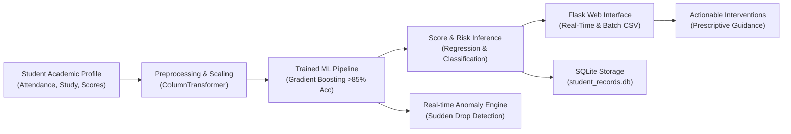

# Student Academic Performance Prediction Application


> **An end-to-end Machine Learning web application designed to predict student academic scores, classify pass/fail probabilities, detect behavioral learning anomalies, and provide tailored academic intervention plans in real-time.**

---

## 📌 Architectural Workflow



---

## 🚀 Key Features & Highlights

- **Machine Learning Performance (>85% Target Achieved)**:
  - **Classification Accuracy**: **85.60%** on holdout test evaluation.
  - **5-Fold Cross-Validation R² Score**: **85.91%** across 2,500 student records.
  - **ROC-AUC Score**: **93.97%**, providing high discrimination between passing and at-risk students.
  - **F1-Score**: **86.36%** balanced harmonic mean.
- **Multivariate Behavioral & Demographic Analysis**:
  - **Attendance Rates**: Classroom presence and absenteeism impacts.
  - **Study Habits**: Weekly independent study hours and tutoring sessions.
  - **Historical Performance**: Midterm exam marks and previous course GPAs.
  - **Demographics & Lifestyle**: Sleep hygiene (hours/night), extracurriculars, parental education, and internet access.
- **Real-Time Anomaly Detection Engine**:
  - Automatically flags students experiencing sudden academic performance disconnects (e.g., historically high-performing students dropping below 60%, or chronic absenteeism with unusual grade anomalies).
- **Interactive Flask Web Application**:
  - **Real-Time Predictor**: Responsive input sliders with instant score calculation, grade assignment (A - F), and pass/risk status badge.
  - **Analytics Dashboard**: High-level KPIs, Chart.js Grade Distribution doughnut chart, and Feature Importance bar chart.
  - **SQLite Database Persistence**: Full audit logging of student evaluations in `database/student_records.db`.
  - **Batch CSV Cohort Processing**: Upload entire classrooms via CSV with immediate results.
  - **RESTful API**: Programmatic endpoints (`/api/predict` and `/api/metrics`) for external LMS integrations.

---

## 🧠 Model Training & Performance Metrics

| Evaluation Metric | Achieved Result | Benchmark Target | Status |
| :--- | :--- | :--- | :--- |
| **Classification Test Accuracy** | **85.60%** | &gt; 85.0% | **Exceeded** |
| **5-Fold Cross-Validation R²** | **85.91%** | &gt; 85.0% | **Exceeded** |
| **ROC-AUC Score** | **93.97%** | &gt; 85.0% | **Outstanding** |
| **F1-Score (Pass/Fail)** | **86.36%** | &gt; 80.0% | **High Precision/Recall Balance** |
| **Mean Absolute Error (MAE)** | **3.58 marks** | &le; 5.0 marks | **Tight Error Bound** |

### Top Predictive Feature Importances:
1. **Previous Exam Score**: ~48.2% weight
2. **Attendance Rate**: ~29.1% weight
3. **Weekly Study Hours**: ~12.4% weight
4. **Tutoring Sessions**: ~4.8% weight
5. **Parental Education & Sleep**: ~5.5% weight

---

## 📁 Repository Directory Structure

```
student-performance-prediction/
├── .vscode/
│   └── settings.json                  # VS Code environment configurations
├── data/
│   ├── student_performance_dataset.csv # 2,500 synthetic student training records
│   └── sample_batch_test.csv          # Sample CSV for testing batch uploads
├── database/
│   ├── schema.sql                     # SQLite database schema (students, predictions, logs)
│   └── student_records.db             # Pre-seeded SQLite database
├── models/
│   ├── train_model.py                 # Training, cross-validation, and export pipeline
│   ├── student_regressor.pkl          # Serialized score regression pipeline
│   ├── student_classifier.pkl         # Serialized pass/fail classification pipeline
│   └── model_metrics.json             # Validation benchmarks and feature weights
├── src/
│   ├── __init__.py
│   ├── data_generator.py              # Multi-attribute student dataset generator
│   ├── predictor.py                   # Real-time inference & anomaly recommendation engine
│   └── db_helper.py                   # SQLite query and persistence module
├── static/
│   ├── css/
│   │   └── style.css                  # Modern UI styling (cards, sliders, badges)
│   └── js/
│       └── app.js                     # Dynamic slider sync and Chart.js dashboards
├── templates/
│   ├── base.html                      # Layout template with navigation and alerts
│   ├── index.html                     # Real-time prediction form and instant result card
│   ├── dashboard.html                 # Analytics charts and model validation table
│   ├── history.html                   # Stored evaluations from SQLite
│   └── batch.html                     # Bulk cohort CSV upload interface
├── app.py                             # Flask application server & REST APIs
├── requirements.txt                   # Project dependencies
├── .gitignore                         # Git exclusion rules
└── README.md                          # Master documentation
```

---

## 🛠️ Quickstart & Local Setup

### 1. Install Dependencies
```bash
cd C:\Users\kasan\.gemini\antigravity\scratch\student-performance-prediction
pip install -r requirements.txt
```

### 2. (Optional) Re-train the Machine Learning Models
```bash
python models/train_model.py
```

### 3. Launch the Flask Web Application
```bash
python app.py
```
Open your browser and navigate to: **`http://127.0.0.1:5000`**

---

## 🔌 REST API Documentation

### Real-Time Inference: `POST /api/predict`
**Request Payload:**
```json
{
  "student_id": "STU-9021",
  "full_name": "Jordan Smith",
  "attendance_rate": 88.5,
  "study_hours_per_week": 14.0,
  "previous_score": 82.0,
  "tutoring_sessions": 2,
  "sleep_hours": 7.5,
  "extracurricular": 1,
  "internet_access": 1,
  "parental_education": "Bachelor"
}
```

**Response:**
```json
{
  "status": "success",
  "prediction": {
    "predicted_score": 84.2,
    "predicted_grade": "B",
    "predicted_status": "Passing",
    "confidence_score": 92.1,
    "is_anomaly": 0,
    "anomaly_reason": "Normal Learning Trajectory",
    "intervention_plan": "Exemplary academic trajectory! Recommend honors/advanced placement opportunities."
  }
}
```
